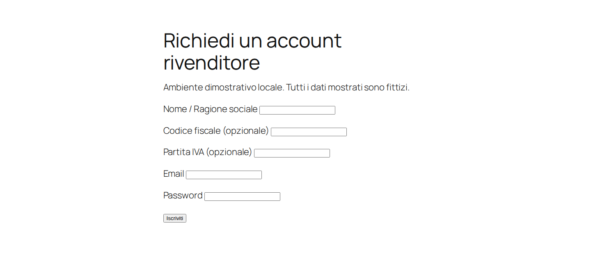
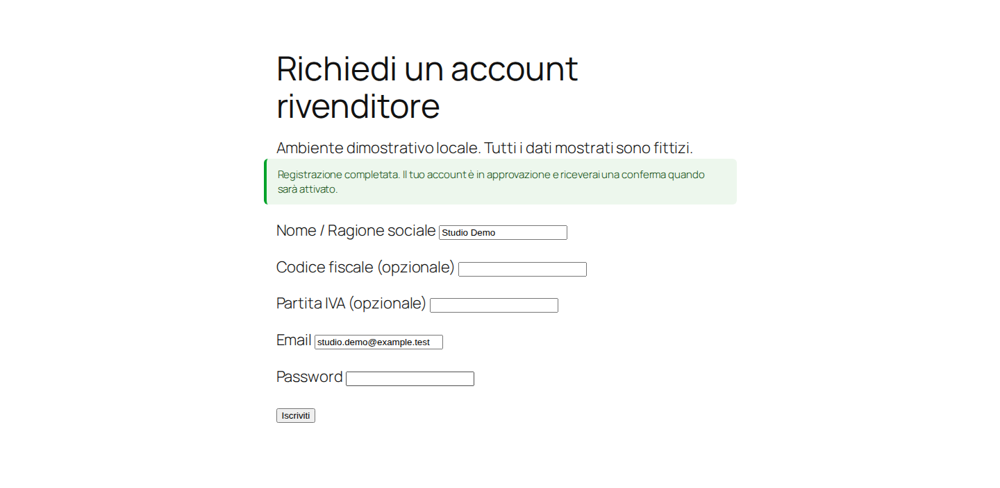
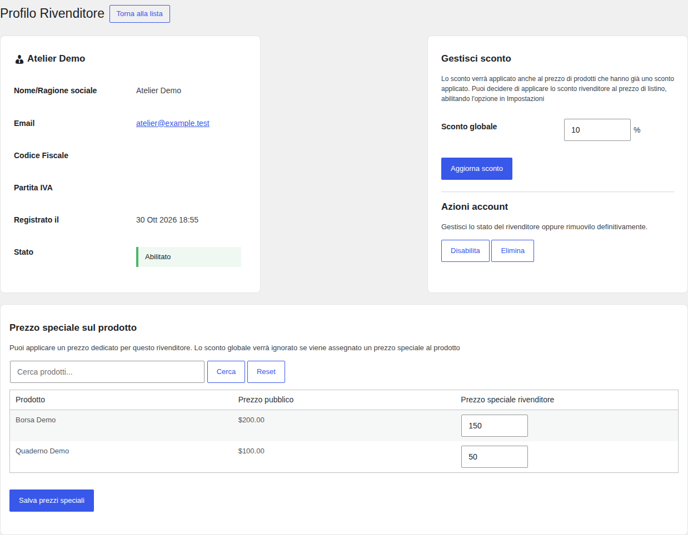
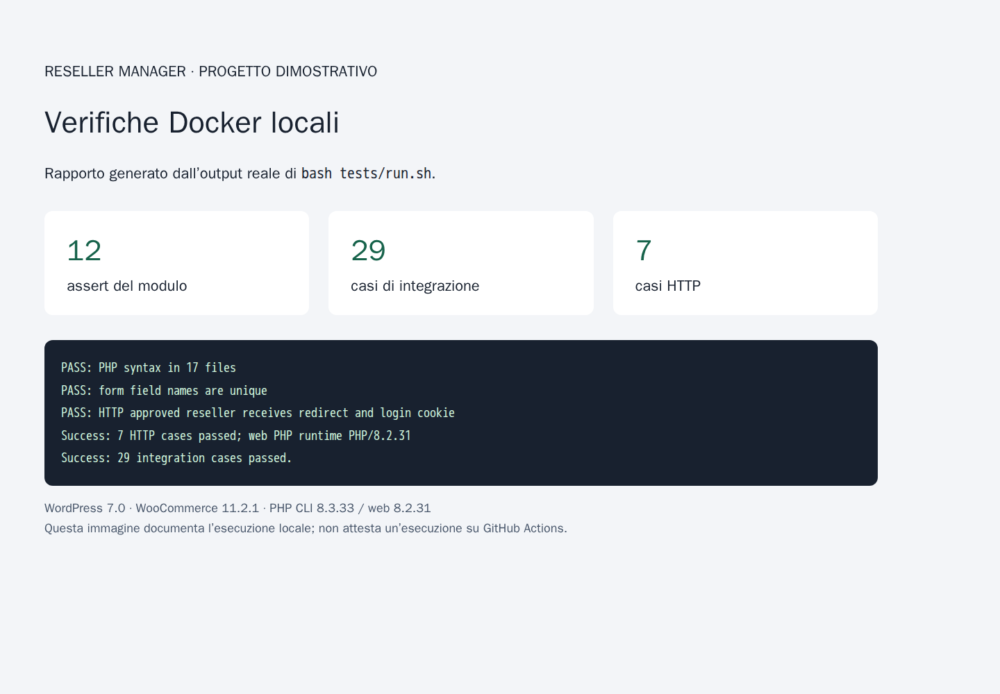

# Reseller Manager — case study tecnico

Progetto dimostrativo di gestione rivenditori per WordPress/WooCommerce.
Il caso documenta un intervento su autorizzazioni, correttezza dei prezzi e test
riproducibili. Non descrive un prodotto commerciale o un'installazione di produzione.

## Contesto e obiettivo

Il plugin implementa iscrizione, approvazione degli account e prezzi riservati.
L'obiettivo dell'intervento era trasformare i rilievi dell'audit in casi riproducibili,
correggere i difetti e rendere verificabili i risultati senza usare un sito esistente.

La prima suite integrata conteneva 18 casi, di cui 14 falliti. La suite finale è
stata estesa a 29 casi di integrazione; i due conteggi non sono una misura della
copertura percentuale del codice. Il [registro dell'audit](../AUDIT.md) distingue
riproduzioni, correzioni e limiti.

## Intervento e risultati verificati

| Area | Problema | Risultato verificato |
| --- | --- | --- |
| Autorizzazioni | Controlli insufficienti su profili e azioni | Utenti non autorizzati respinti; destinatari limitati ai rivenditori |
| Prezzi | HTML assegnato a un valore numerico, ciclo interrotto e ricalcoli incoerenti | Prezzi numerici su più righe, sconti stabili e prezzo regolare conservato |
| Account | Dati dei moduli incoerenti e password trattata come testo | Iscrizione in attesa, campi indipendenti e login dopo approvazione |
| Interfaccia | Output shortcode/blocchi e moduli annidati | Form restituiti/renderizzati e separati |
| Persistenza | Salvataggio paginato sovrascrive altri prezzi | Conservazione dei prodotti non modificati |
| Disinstallazione | SQL non valido e pulizia troppo ampia | API WordPress, chiavi esatte e conservazione di account/contenuti |

Esecuzione locale del 30 ottobre 2026: **12 assert del modulo, 29 casi di integrazione,
7 casi HTTP**, tutti superati; lint su **17 file PHP**. L'[output integrale](test-output.txt)
è quello catturato dal runner, senza sostituire il risultato con un report simulato.
Il codice applicativo verificato corrisponde alla
[revisione 3f4e199](https://github.com/matteodev/reseller_manager/tree/3f4e199904922f8fb88ca665f9822cdb1d2422ed).
Gli incrementi successivi aggiungono licenza, CI, documentazione e strumenti di acquisizione.

Configurazione: WordPress 7.0, WooCommerce 11.2.1, MariaDB 10.11,
PHP CLI 8.3.33 e web 8.2.31. Non sono stati misurati benefici commerciali,
prestazionali o una percentuale di copertura del codice.

## Evidenze visive

Tutti i nomi, account e prodotti nelle schermate sono fittizi. Le prime tre immagini
provengono da WordPress nel Docker locale; la quarta è un rapporto visuale costruito
sull'output del runner, non una schermata di GitHub Actions.



*Modulo di iscrizione della demo locale.*



*Conferma dopo un invio reale del modulo nel browser.*



*Amministrazione di un account fittizio e di due prodotti dimostrativi.*



*Riepilogo visuale del log locale, con i tre livelli di verifica separati.*

## Ripetere le verifiche

```sh
bash tests/run.sh
```

Il runner crea ed elimina un proprio progetto Docker. Le immagini sono fissate
per digest e WooCommerce per versione. Il [workflow Docker tests](../../.github/workflows/docker-tests.yml)
esegue lo stesso comando su push, pull request e avvio manuale; conserva il log come
artifact per 14 giorni. Usa azioni ufficiali [checkout](https://github.com/actions/checkout)
e [upload-artifact](https://github.com/actions/upload-artifact), fissate a commit.
Il workflow è stato validato localmente con actionlint 1.7.7. La presenza del file
non attesta un'esecuzione remota: verificarne l'esito nella
[scheda Actions](https://github.com/matteodev/reseller_manager/actions/workflows/docker-tests.yml)
dopo il push. Nessun badge verde o esito remoto è dato per acquisito.

## Riprodurre le schermate

Da una copia del repository, con Docker e connessione internet:

```sh
bash tools/case-study-fixtures.sh
# Se non è già disponibile, generare il log per il rapporto visuale:
bash tests/run.sh > docs/case-study/test-output.txt 2>&1

docker run --rm --user "$(id -u):$(id -g)" \
  --network reseller-case-study_default \
  -v "$PWD:/app:ro" \
  -v "$PWD/docs/case-study/assets:/output" \
  mcr.microsoft.com/playwright:v1.58.2-noble@sha256:6446946a1d9fd62d9ae501312a2d76a43ee688542b21622056a372959b65d63d \
  bash -c 'npm install --prefix /tmp/capture-runtime --cache /tmp/npm-cache --ignore-scripts --no-audit --no-fund playwright@1.58.2 && NODE_PATH=/tmp/capture-runtime/node_modules node /app/tools/capture-case-study.cjs'

docker compose -p reseller-case-study -f compose.integration.yaml down --volumes --remove-orphans
```

Usare questi comandi solo per la demo: le fixture creano account/prodotti fittizi e
ripuliscono l'account `studio.demo@example.test` per permettere una nuova acquisizione.
Le credenziali del relativo amministratore sono segnaposto di test nel setup.
L'acquisizione controlla visibilità del form, conferma di iscrizione e accesso al
profilo; non è una suite browser completa né verifica l'invio reale delle email.
Le traduzioni sono scaricate per `it_IT`; il database della demo resta separato dal runner.

## Limiti e prossimi passi

Restano da verificare prodotti variabili, tasse/coupon complessi, Store API e Checkout
Blocks, email/reset link, multisite, altre versioni e plugin di pricing esterni.
L'audit di sicurezza non è esaustivo. Il plugin rimane dimostrativo. Non è stato
eseguito alcun intervento su matcode.dev.

Licenza del codice: **GPL-2.0-or-later**, coerente con l'header esistente; testo in
[LICENSE](../../LICENSE), recuperato dalla [raccolta SPDX](https://github.com/spdx/license-list-data/blob/main/text/GPL-2.0-or-later.txt).
Screenshot e rapporto sono materiali generati per questo progetto con dati fittizi;
il log e le schermate non modificano le licenze dei componenti WordPress/WooCommerce.
